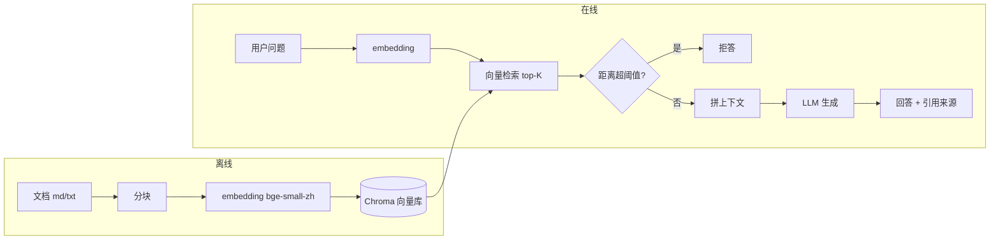

# 课程资料 RAG 问答助手

一个基于本地向量检索的课程资料问答系统：上传 Markdown/txt，提问后得到**带引用来源**的回答，资料中没有依据时**明确拒答**。

> 技术栈：Python · Chroma · sentence-transformers (bge-small-zh) · Streamlit · LLM (DeepSeek/OpenAI)


<!-- 放一张 Streamlit 问答 + 引用展开的截图 -->


---

## 为什么做这个

大模型本身不知道你的课程资料，直接问会编造。RAG 的思路是：**先从你的资料里检索相关段落，再让模型基于这些段落回答**。

但一个可用的 RAG 不是“检索 + 拼 prompt”就完事，还要解决三个问题：

- **检索准不准**：找出来的段落是不是真的相关
- **会不会乱答**：资料里没有的，模型会不会硬编
- **来源可不可信**：回答引用的出处是不是真的存在

这个项目围绕这三点做了检索、拒答和引用溯源，并自建评测集量化效果。

---

## 架构



---

## 快速开始

### 1. 安装依赖

```bash
python -m venv venv
source venv/bin/activate        # Windows: venv\Scripts\activate
pip install -r requirements.txt
```


### 2. 下载 embedding 模型到本地

```bash
hf download BAAI/bge-small-zh-v1.5 --local-dir models/bge-small-zh-v1.5
```


> `huggingface-cli` 已废弃，新命令是 `hf`。国内网络慢可先设 `HF_ENDPOINT=https://hf-mirror.com`。

### 3. 配置环境变量

复制 `.env.example` 为 `.env`，填入自己的 key：

```.env
LLM_API_KEY=your_api_key_here
LLM_BASE_URL=https://api.deepseek.com/v1
LLM_MODEL=deepseek-chat
```


### 4. 入库

把文档放到 `data/raw/`，然后：

```bash
python ingest.py
```


### 5. 启动界面

```bash
streamlit run app.py
```


### 6. 运行评测

```bash
python eval/run_eval.py
```


------

## 核心设计决策

### 为什么用 bge-small-zh-v1.5？

- 中文优化，检索效果比通用模型好
- 512 维，体积小，CPU 可跑
- 本地推理，免费、离线、可换模型

查询侧加了 bge 要求的指令前缀，文档侧不加，这是模型训练方式决定的，不加会掉召回。

### 为什么分块带 overlap？

按 300 字符切块，块间重叠 60 字符。固定长度切块会切断句子，overlap 保证跨块语义在至少一个块中完整出现，减少检索时的上下文丢失。

### 为什么需要拒答？

向量检索**永远会返回 top-K**，哪怕问题跟资料完全无关。如果不判断，LLM 会拿着不相关的段落硬编答案。

所以加了距离阈值：最相关的块距离超过阈值，直接拒答，返回固定话术“根据现有资料无法回答该问题”。

### 为什么要求固定引用格式？

System prompt 要求模型用 `[doc:文件名#块编号]` 标注来源。固定格式有三个好处：

1. 用户能验证答案出处
2. 评测脚本能用正则自动抽取引用
3. 可以校验引用是否真实存在于检索结果中，防止编造来源

### 为什么不用 LangChain？

想理解 RAG 的底层链路：分块、embedding、向量检索、拼上下文。框架会隐藏这些细节，出问题难定位。

------

## 评测

自建 20 条评测集：15 条文档内问题 + 5 条文档外问题（拒答测试）。

运行 `python eval/run_eval.py` 可复现：

| 指标       | 结果         | 说明                               |
| :--------- | :----------- | :--------------------------------- |
| Recall@K   | 100% (15/15) | 相关文档是否出现在检索结果前 K 条  |
| 拒答准确率 | 100% (5/5)   | 文档外问题是否正确拒答             |
| 引用有效率 | 100% (15/15) | 回答引用的块是否真实存在于检索结果 |
| 引用命中率 | 100% (15/15) | 引用的文件是否覆盖期望的相关文档   |

> K = `config.TOP_K`，当前为 10。

------

## 踩坑与优化

### 1. 相对路径导致静默查空库

**问题**：`CHROMA_PATH = "data/chroma"` 是相对路径。从 `eval/` 目录运行时，实际打开的是 `eval/data/chroma`——一个被 Chroma 自动创建的空库。查询返回空结果，但不报任何错，评测全部 0%，却看不出原因。

**修复**：所有项目内路径锚定 `Path(__file__)`：

```
BASE_DIR = Path(__file__).resolve().parent
CHROMA_PATH = str(BASE_DIR / "data" / "chroma")
```


并在评测脚本开头加空库检查，把静默失败变成显式报错：

```
if collection.count() == 0:
    print("错误: Chroma 集合为空, 请先运行 python ingest.py")
    sys.exit(1)
```


### 2. 距离阈值误拒相关问题

**问题**：初版阈值 1.0，实测相关问题 top-1 距离在 0.52~1.14，无关问题在 1.14~1.36。1.0 把 5 个相关问题挡在 LLM 门外，直接拒答。

**修复**：阈值改为 1.15，相关问题全部放行，无关问题靠 system prompt 的拒答规则兜底。

### 3. TOP_K 太小，正确块进不了上下文

**问题**：ResNet、LSTM 的答案在 `nn.md` 的同一个块里，但向量检索时该块排在 top-5 之外，LLM 拿不到答案。文件级 Recall 命中（`nn.md` 在 top-5），但块级没命中。

**修复**：`TOP_K` 从 5 提到 10，正确块进上下文，回答正常。

**这也暴露了指标局限**：文件级 Recall 无法反映“命中的块对不对”。后续可标注 chunk 级别做更细的评测。

### 4. `retrieve` 忽略 `top_k` 参数

**问题**：`retrieve(query, top_k=5)` 里，`collection.query` 硬编码用了 `TOP_K`，传参无效。

**修复**：`n_results=top_k`，让参数真正生效。

------

## 项目结构

```text
course-rag/
├── app.py                  # Streamlit 界面
├── ingest.py               # 文档入库
├── rag.py                  # 检索 + 拒答 + 生成
├── chunker.py              # 分块
├── embedder.py             # embedding 封装
├── config.py               # 配置（路径、阈值、top_k）
├── llm.py                  # LLM 客户端
├── data/
│   ├── raw/                # 原始文档
│   └── chroma/             # 向量库（不入库 git）
├── models/                 # 本地 embedding 模型（不入库 git）
├── eval/
│   ├── eval_set.jsonl      # 评测集
│   └── run_eval.py         # 评测脚本
├── docs/
│   └── demo.png
├── requirements.txt
└── README.md
```


------

## 后续计划

- **加 Reranker**：向量粗排 top20 → cross-encoder 精排 top5，减少送进 LLM 的块数，降低噪声和成本
- **混合检索**：BM25 + 向量，改善专有名词（如 RoPE、ResNet）的召回
- **引用运行时校验**：生成后检查引用是否真实存在于检索结果，不在则重试或降级拒答
- **多轮对话 + 查询改写**：把“它是什么”补全成完整问题再检索
- **块级评测**：标注相关 chunk_id，替代当前的文件级 Recall

------

## 局限

- 评测集仅 20 条，指标已达上限，无法区分进一步优化的收益
- Recall 是**文件级**，不能反映命中的块是否包含答案
- 固定长度分块会切断跨块的语义
- 拒答靠全局距离阈值，不同问题类型距离分布不同，阈值需重调

------

## License

MIT