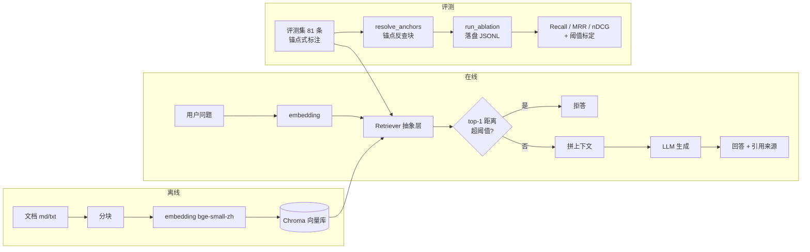

# 课程资料 RAG 问答助手

一个基于本地向量检索的课程资料问答系统：上传 Markdown/txt，提问后得到**带引用来源**的回答，资料中没有依据时**明确拒答**。

> 技术栈：Python · Chroma · sentence-transformers (bge-small-zh) · Streamlit · LLM (DeepSeek/OpenAI)
>
> 语料 1210 块 / 评测集 81 条 / 检索基线 R@1 = 0.281、R@20 = 0.789

这个项目的重点不在"能跑通"，而在**能测出差异**：块级评测集 + 三路消融，每一步优化都有数字支撑，反直觉的结果也照实写进[评测](#评测)章。


<!-- 放一张 Streamlit 问答 + 引用展开的截图 -->


---

## 为什么做这个

大模型本身不知道你的课程资料，直接问会编造。RAG 的思路是：**先从你的资料里检索相关段落，再让模型基于这些段落回答**。

但一个可用的 RAG 不是“检索 + 拼 prompt”就完事，还要解决三个问题：

- **检索准不准**：找出来的段落是不是真的相关
- **会不会乱答**：资料里没有的，模型会不会硬编
- **来源可不可信**：回答引用的出处是不是真的存在

这个项目围绕这三点做了检索、拒答和引用溯源，并自建评测集量化效果。

---

## 架构



`Retriever` 是一个 Protocol，不是具体类。当前只有 `VectorRetriever` 一个实现；P2 加 BM25、P3 加重排，都只是往 `retrieval/pipeline.py` 的工厂里加一个分支，`rag.py` 一行不用改。

---

## 快速开始

### 1. 安装依赖

```bash
python -m venv venv
source venv/bin/activate        # Windows: venv\Scripts\activate
pip install -r requirements.txt
```


### 2. 下载 embedding 模型到本地

```bash
hf download BAAI/bge-small-zh-v1.5 --local-dir models/bge-small-zh-v1.5
```


> `huggingface-cli` 已废弃，新命令是 `hf`。国内网络慢可先设 `HF_ENDPOINT=https://hf-mirror.com`。

### 3. 配置环境变量

复制 `.env.example` 为 `.env`，填入自己的 key：

```.env
LLM_API_KEY=your_api_key_here
LLM_BASE_URL=https://api.deepseek.com/v1
LLM_MODEL=deepseek-chat
```


### 4. 入库

把文档放到 `data/raw/`，然后：

```bash
python ingest.py
```


### 5. 启动界面

```bash
streamlit run app.py
```


### 6. 运行评测

```bash
python eval/anchors.py              # 校验评测集锚点在当前语料上唯一(命中 0 或 >=2 块即报错)
python eval/run_ablation.py         # 跑检索 -> 落盘 JSONL -> 打印指标表
python eval/calibrate_threshold.py  # 拒答阈值标定(扫 TPR/FPR)
python eval/run_eval.py             # 端到端回归(含 LLM 生成,需要 key)
```


------

## 语料

| 来源 | 文档数 | 许可 | 说明 |
| :--- | ---: | :--- | :--- |
| [d2l-zh](https://github.com/d2l-ai/d2l-zh) | 11 | CC BY-SA 4.0 | 《动手学深度学习》中文版选章 |
| [hf-course](https://github.com/huggingface/course) | 20 | Apache-2.0 | Hugging Face NLP 课程中文版 |
| [transformers-zh](https://github.com/huggingface/transformers-docs) | 10 | Apache-2.0 | Transformers 中文文档 |
| 自建笔记 | 3 | — | 课程笔记,保持"课程资料"定位锚点 |

合并后 **44 篇 / 正文 28.8 万字 / 分块 1210 块**,语料指纹 `690ddab8592f`。（块字符总数 35.7 万，比正文多出的部分是 60 字符 overlap 的重复。）

抓取脚本 `scripts/fetch_corpus.py` 只用 raw 直链、零 API 调用(GitHub API 按出口 IP 限流 60 次/小时,实测 21 次探测后必 403),41 个文件全部 pin 到具体 SHA,任何人重跑都得到同一份语料。

开源语料在 `data/raw/fetched/`,`ingest.py` 用 `rglob` 递归收录。**d2l-zh 是 CC BY-SA 4.0(带 share-alike),所以语料文件不提交进仓库**,只提交抓取脚本 —— 克隆后跑 `fetch_corpus.py` 即可复原。

清洗掉六类标记噪音:Notion 锚点 `[[..]]`、`:numref:` 指令、HTML 注释、mdx `import` 语句、独占一行的标签、跨行自闭合 JSX 组件。

清洗是**最容易出静默错误**的一环:规则写错不会报错,只会让文件变小、回答变差,而这两件事都很难归因。所以抓取时加了一条不变量——**只删标记的规则,不该改变代码围栏的奇偶性**:清洗后数一遍 ``` 的个数,奇数就说明某条正则吞掉了正文,直接 `raise`。见踩坑 #7。

---

## 核心设计决策

### 为什么用 bge-small-zh-v1.5？

- 中文优化，检索效果比通用模型好
- 512 维，体积小，CPU 可跑
- 本地推理，免费、离线、可换模型

查询侧加了 bge 要求的指令前缀，文档侧不加，这是模型训练方式决定的，不加会掉召回。

### 为什么分块带 overlap？

按 300 字符切块，块间重叠 60 字符。固定长度切块会切断句子，overlap 保证跨块语义在至少一个块中完整出现，减少检索时的上下文丢失。

代价是有 60 字符的"歧义区"：落在这里的句子同时属于相邻两块。评测集的锚点标注必须避开它（见踩坑 #8）。

**这套分块后来被数据证明是当前的瓶颈**：64 道有 gold 的题里 11 道 gold 块没进 top-20，其中 6 道目标文档排在前 20 名以内——文档找对了，块找错了。定长窗口不看标题、不看段落边界，切出来的块是"什么都沾一点"的语义平均值。P4 会换成标题感知的结构分块。

### 为什么需要拒答？

向量检索**永远会返回 top-K**，哪怕问题跟资料完全无关。如果不判断，LLM 会拿着不相关的段落硬编答案。

所以加了距离阈值：最相关的块距离超过阈值，直接拒答，返回固定话术“根据现有资料无法回答该问题”。

### 为什么要求固定引用格式？

System prompt 要求模型用 `[doc:文件名#块编号]` 标注来源。固定格式有三个好处：

1. 用户能验证答案出处
2. 评测脚本能用正则自动抽取引用
3. 可以校验引用是否真实存在于检索结果中，防止编造来源

### 为什么不用 LangChain？

想理解 RAG 的底层链路：分块、embedding、向量检索、拼上下文。框架会隐藏这些细节，出问题难定位。

------

## 评测

### 评测集：81 条，块级标注

第一版评测集只有 20 条、文件级标注，全 100%——语料只有 10 块时，`top_k=10` 会把整个语料塞进上下文，任何检索优化都测不出来。**测量的分辨率先于优化**，所以重做成了块级。

| 类别 | 数量 | 测什么 |
| :--- | ---: | :--- |
| term-match | 25 | 专有名词/公式直问（"什么是 Xavier 初始化"）——词面匹配的优势区 |
| paraphrase | 21 | 换说法问（"为什么深层网络训练不动了"）——向量的优势区 |
| multi-chunk | 10 | 答案跨 2~3 块，标注全部相关块 |
| partial | 8 | 语料提到但没展开——测"照实说没讲"的边界 |
| ood | 10 | 完全无关（天气、菜谱） |
| ood-adjacent | 4 | 相邻领域（语料里没有的学科） |
| ood-pseudo | 3 | **伪相关**：词面重叠但语料里没有答案 |

拒答题（后三类共 17 条）的 gold 为空，在所有指标里记为 `nan` 而不是 0——`mean()` 跳过 nan，让它们不参与检索指标，只在拒答指标里出现。

### 标签为什么用"锚点"而不是 chunk_id

一条 multi-chunk 标注长这样：

```json
{"id": "c59", "category": "multi-chunk", "query": "多头注意力为什么要分成多个头",
 "anchors": ["我们希望模型可以基于相同的注意力机制学习到不同的行为",
             "最后，将这$h$个注意力汇聚的输出拼接在一起，"],
 "relevant_docs": ["d2l-zh__chapter_attention-mechanisms__multihead-attention.md"]}
```

锚点是目标块内的**唯一短句**，评测时反查"包含该句的块"得到 chunk key。这样换分块策略、chunk_id 全部漂移后评测集依然有效——Phase 4 重切语料时不用重标。硬编码 chunk_id 的话，调一次 chunk_size 就得重标一次，实际上等于不允许调。

代价是锚点必须在全库唯一。1210 块靠人眼查不现实，所以写了 `scripts/suggest_anchors.py`：给候选句，报它命中几块、落在哪、偏移多少；撞车时自动扩成"刚好唯一"的最短片段。`eval/anchors.py` 在跑评测前校验全部 81 条，**命中 0 块或 ≥2 块直接抛错**——在边界处响亮失败，好过把 gold 悄悄算错。

### 向量检索基线

`python eval/run_ablation.py`，语料指纹 `690ddab8592f`，n = 64（有 gold 的题）。

| 指标 | R@1 | R@3 | R@5 | R@10 | R@20 | MRR@10 | nDCG@10 |
| :--- | ---: | ---: | ---: | ---: | ---: | ---: | ---: |
| vector | 0.281 | 0.453 | 0.508 | 0.703 | 0.789 | 0.427 | 0.479 |

按类别拆开（**看清 n——8 条题上的 0.05 差距是噪声，不是结论**）：

| 类别 | n | R@1 | R@3 | R@10 | R@20 | MRR@10 | nDCG@10 |
| :--- | ---: | ---: | ---: | ---: | ---: | ---: | ---: |
| term-match | 25 | 0.360 | 0.440 | 0.760 | 0.840 | 0.441 | 0.513 |
| paraphrase | 21 | 0.333 | 0.571 | 0.762 | 0.905 | 0.470 | 0.539 |
| multi-chunk | 10 | 0.100 | 0.400 | 0.700 | 0.750 | 0.498 | 0.471 |
| partial | 8 | 0.125 | 0.250 | 0.375 | 0.375 | 0.182 | 0.227 |

**R@1 = 0.281 而 R@20 = 0.789：瓶颈在排序，不在召回。** 近八成的题，正确答案已经躺在候选池里，只是没排到前面。这正是两段式（混合检索 + 重排）要打的位置，也是继续加大 `COARSE_K` 收益递减的证据。

paraphrase 的 R@1 只有 0.333 但 R@20 高达 0.905——向量**找得到**这些块，排序很差。multi-chunk 的 R@1 = 0.100 是意料之中：答案本来就散在 2~3 块里，指望第一块就命中不现实，该看 R@10。

### 拒答阈值标定

`python eval/calibrate_threshold.py`。现行闸门只卡 **top-1 的距离**（`candidates[0].vector_distance > 阈值` → 拒答），所以标定用同一口径：正样本 = 有 gold 的题的 top-1 距离，负样本 = OOD 题的 top-1 距离。

| 阈值 | 误拒 /53 | 误答 /17 |
| ---: | ---: | ---: |
| 0.62 | 32（60.4%） | 0 |
| **0.90（现行）** | **4（7.5%）** | **5（29.4%）** |
| 0.95 | 2（3.8%） | 6（35.3%） |
| 1.15（旧值） | 0 | 13（76.5%） |

旧阈值 1.15 是在"3 篇文档 / 10 块"时代拍的，在 1210 块的语料上 17 条 OOD 放行了 13 条——**闸门形同虚设**。原因是候选密度涨了 120 倍：多出来的 1200 块讲的都是同一门课，离任何 query 都不算远，top-1 距离整体被拉近。

**但调阈值救不了这个——这是结构性上限。** 有 5 条 OOD 埋在正样本的 p25~p75 区间 [0.593, 0.798] 里：

| 距离 | 类别 | 查询 | 实际检索到的 top-1 |
| ---: | :--- | :--- | :--- |
| 0.626 | ood-pseudo | 我的模型梯度不更新了怎么办 | `adam.md#4`（Adam 更新公式） |
| 0.716 | ood-pseudo | 训练 BERT 需要多少张 GPU | `backprop.md#22`（真在讲多 GPU 划分） |
| 0.756 | ood-adjacent | 如何用 SQL 做分组统计 | `chapter6/3#49`（偏移映射） |
| 0.770 | ood-pseudo | Transformer 一共有多少参数 | `chapter1/4#4`（真在讲 Transformer） |
| 0.799 | ood-adjacent | 模型的 dropout 率一般设多少 | `dropout.md#26`（真写着"暂退概率设为 0.2 和 0.5"） |

要把误答压到 0，阈值得降到 0.62，那时误拒 32/53 = 60%——一半以上的正常问题答不出来。**根因：embedding 距离量的是"话题相关"，不是"能不能回答"。**"语料在讲 Transformer" 和 "语料讲了 Transformer 有多少参数" 是两个不同的事实，双塔向量看不出区别。

后续有两条路，都还没做：Phase 3 完成后用 **reranker 分数**当闸门重标一次（cross-encoder 对"这块回答了这个问题吗"比双塔敏锐得多）；或者干脆放弃单一阈值，改成生成侧的"资料没讲"判断。

### 一个更值钱的发现：分块在杀死检索

64 道有 gold 的题里，11 道（17.2%）的 gold 块**完全没进 top-20**。拆开看，其中 6 道的目标文档排得非常靠前：

| 题 | gold 块排名 | 该文档**首次**出现的排名 |
| :--- | ---: | ---: |
| c70 BillSum 数据集 | 31 | **1** |
| c69 T5 模型结构 | 672 | **3** |
| c68 DistilBERT | 541 | **12** |
| c47 为什么随机初始化权重 | 44 | **1** |
| c49 注意力掩码 | 44 | 20 |
| c71 Reformer | 54 | 54 |

**文档找对了，块找错了。** 向量检索明明知道该看哪一篇（甚至排第 1），却定位不到具体那一段。这指向 `chunker.py` 的定长切片——300 字符的固定窗口不看标题、不看段落边界，切出来的块是一个"什么都沾一点"的语义平均值，和精确提问对不上。

这比 "R@20 = 0.789" 这类聚合数字有力得多：它指明了下一次优化的方向是**分块**而不是检索。

另一类问题在自建笔记上：c10/c11/c12/c17/c27 的目标是 `nn.md`（3 块）、`transformer.md`（4 块）、`project.md`（3 块）。问 "ResNet 是什么"，`nn.md` 的三块排到第 79 / 201 / 985 名——300 字的笔记摘要块在 1210 块教材正文里被淹没。

### 附录：指标口径

- **R@K 是覆盖率不是二值命中**：3 个 gold 块里命中 2 个记 2/3，不是 1。
- **拒答题在检索指标里是 nan 不是 0**：否则"拒答正确"会被记成"检索失败"。
- **跨语料指纹的数字不可比**：`corpus_tag` 是对全库 `(key, text)` 取 sha256 的前 12 位。抓取脚本改一行、chunk_size 调一次，指纹就变，旧数字全部作废。报告里两者必须一起出现。

------

## 踩坑与优化

### 1. 相对路径导致静默查空库

**问题**：`CHROMA_PATH = "data/chroma"` 是相对路径。从 `eval/` 目录运行时，实际打开的是 `eval/data/chroma`——一个被 Chroma 自动创建的空库。查询返回空结果，但不报任何错，评测全部 0%，却看不出原因。

**修复**：所有项目内路径锚定 `Path(__file__)`：

```
BASE_DIR = Path(__file__).resolve().parent
CHROMA_PATH = str(BASE_DIR / "data" / "chroma")
```


并在评测脚本开头加空库检查，把静默失败变成显式报错：

```
if collection.count() == 0:
    print("错误: Chroma 集合为空, 请先运行 python ingest.py")
    sys.exit(1)
```


### 2. 距离阈值误拒相关问题

**问题**：初版阈值 1.0，实测相关问题 top-1 距离在 0.52~1.14，无关问题在 1.14~1.36。1.0 把 5 个相关问题挡在 LLM 门外，直接拒答。

**修复**：阈值改为 1.15，相关问题全部放行，无关问题靠 system prompt 的拒答规则兜底。

> 这个 1.15 后来被推翻了。语料从 10 块扩到 1210 块后重标，它在 17 条拒答题上放行了 13 条。详见[评测](#拒答阈值标定)章——**在旧语料上标定的参数，换语料后必须重标，不能继承。**

### 3. TOP_K 太小，正确块进不了上下文

**问题**：ResNet、LSTM 的答案在 `nn.md` 的同一个块里，但向量检索时该块排在 top-5 之外，LLM 拿不到答案。文件级 Recall 命中（`nn.md` 在 top-5），但块级没命中。

**修复**：`TOP_K` 从 5 提到 10，正确块进上下文，回答正常。

**这也暴露了指标局限**：文件级 Recall 无法反映“命中的块对不对”。后续可标注 chunk 级别做更细的评测。

### 4. `retrieve` 忽略 `top_k` 参数

**问题**：`retrieve(query, top_k=5)` 里，`collection.query` 硬编码用了 `TOP_K`，传参无效。

**修复**：`n_results=top_k`，让参数真正生效。

> #3 和 #4 里的 `TOP_K`、`retrieve()` 在 P1 重构时已经拆掉了：`TOP_K` 变成 `COARSE_K`（粗排候选数）和 `FINAL_K`（送进 LLM 的块数）两个旋钮，检索逻辑搬进了 `retrieval/`。这里保留原文是因为**踩坑本身有价值**——#3 是"文件级指标掩盖了块级失败"的第一个证据，#4 是"参数传了但没生效"的典型。但别去代码里找 `TOP_K` 了。

### 5. 校验器只检查了第一条——静默通过最危险

**问题**：`eval/anchors.py` 里 `validate()` 的 `return errors` 缩进在 `for` 循环内部，检查完第一条就返回。调用方拿到空列表，解读为"全部 81 条锚点都没问题"，实际上只校验了 1 条。

**修复**：取消缩进。用"在第 2 位和最后一位注入一个错误锚点"验证修复——两处都被抓到才算真的修好。

**教训**：这个 bug 不会崩、不会报错、不会让任何一个数字变得离谱，它只是让**一份本该失败的校验静默通过**。这类 bug 比崩溃难发现一个数量级。所以校验代码自己也需要被测试——"校验通过了"这句话要能拿出证据。

### 6. `glob("*")` 漏掉子目录，入库静默少十几篇文档

**问题**：`ingest_all()` 用 `data/raw/glob("*")` 找文档，但开源语料抓在 `data/raw/fetched/` 子目录里。`glob` 不递归，而 `fetched` 是个没有 `.md` 后缀的目录，在两个检查点上都被跳过——不报错，只是库里的文档少了。

**修复**：改用 `rglob("*")`，并按文件名排序保证入库顺序确定（块 id 不随文件系统枚举顺序漂移）。

### 7. 清洗正则吃掉整段正文

**问题**：为删掉跨行的 `<Question ... />` JSX 组件写了 `^[ \t]*<[A-Za-z][\w.-]*\b.*?/>[ \t]*$` 配 `DOTALL`。正文里独占一行的 `<a href="...">` 会成为匹配起点，然后懒匹配一路扫到很远的下一个 `/>`，把中间的代码块整段带走。

**症状**：hf-course 从 172 KB 掉到 141 KB，且**没有任何报错**——文件写进去了，只是内容少了。

**修复**：在结束引号前加 `[^>\n]*\n`，要求开始标签不在同一行闭合。

**更有价值的修复是那道守卫**：清洗后数一遍 ``` 的个数，**奇数就说明某条规则吞掉了正文**（代码围栏必然成对）。这个奇偶校验在 `fetch_corpus.py` 里直接 `raise`。

需要说清楚的是：**这个 bug 是靠肉眼看文件体积不对发现的**（172 KB → 141 KB），不是靠守卫——守卫是修完之后才加的。体积异常是个很弱的信号，得先知道原文件多大才看得出来，而清洗规则改动频繁，没人记得住每个文件该多大。守卫把"感觉体积不太对"换成了一条明确的断言：**只删标记的规则不该改变代码围栏的奇偶性**。下次同类的正则错误会在抓取阶段就炸，而不是等到入库以后发现回答变差。

### 8. 评测锚点跨在 chunk overlap 边界上

**问题**：`chunk i` 覆盖 `[240i, 240i+300)`，相邻块重叠 60 字符。锚点落在这 60 字符里时会同时命中两块，`resolve_anchors` 判定为歧义。

**修复**：不手算安全区，直接对全库实测唯一性。理论上的安全区 `[overlap, chunk_size - overlap)` 只用来提示"往哪儿找"，判定标准始终是"全库实测只有一块包含它"——因为跨文档撞车、重复段落这些情况算不出来，只能测。

顺带发现一个更隐蔽的：撞车的锚点需要**扩成刚好唯一的最短片段**，但第一版 `minimal_unique` 用"当前只命中一块"当守卫——等于要求它先别撞车才肯帮忙修撞车，于是每次都直接返回 `None`。基准块必须由调用方显式指定。

------

## 项目结构

```text
course-rag/
├── app.py                      # Streamlit 界面
├── config.py                   # 全部实验旋钮集中于此(ablation 可复现的前提)
├── db.py                       # Chroma client + collection(单独成模块,
│                               #   否则 import ingest 就会触发建库副作用)
├── ingest.py                   # 文档入库
├── chunker.py                  # 分块
├── embedder.py                 # embedding 封装
├── llm.py                      # LLM 客户端
├── rag.py                      # 检索 + 拒答 + 生成
├── retrieval/                  # 检索器抽象层,后续所有模块的接缝
│   ├── base.py                 #   ScoredChunk 数据结构 + Retriever Protocol
│   ├── vector.py               #   纯向量检索(当前实现)
│   └── pipeline.py             #   工厂:按 config.RETRIEVER 选实现
├── eval/
│   ├── anchors.py              # 锚点加载/校验/解析(命中 0 或 >=2 块即报错)
│   ├── eval_set_chunks.jsonl   # 评测集 81 条
│   ├── metrics.py              # Recall / MRR / nDCG
│   ├── run_ablation.py         # 跑检索 -> 落盘 JSONL -> 打指标表
│   ├── calibrate_threshold.py  # 拒答阈值标定(TPR/FPR 扫描)
│   ├── run_eval.py             # 端到端回归(含 LLM)
│   └── results/                # 落盘结果(不入库 git)
├── scripts/
│   ├── fetch_corpus.py         # 抓取开源语料(纯 raw 直链 + pin SHA)
│   └── suggest_anchors.py      # 扩评测集时的锚点辅助工具
├── data/
│   ├── raw/                    # 自建笔记
│   │   └── fetched/            # 抓取的开源语料(不入库 git,CC BY-SA)
│   └── chroma/                 # 向量库(不入库 git)
├── models/                     # 本地 embedding 模型(不入库 git)
├── docs/
│   └── demo.png
├── requirements.txt
└── README.md
```

**`ScoredChunk` 是后续所有阶段的共同数据格式**——同一个对象上挂 `vector_distance` / `bm25_score` / `fusion_score` / `rerank_score` 四个分数，每个检索器只填自己那一个。这样加一路检索器不用改调用方，也天然避免了"把三种不同尺度的分数直接相加"这个经典错误：RRF 只吃名次，拒绝门只看 `vector_distance`。


------

## 路线图

主线是**检索效果**，每一步都拿上一阶段的评测数据说话。

| 阶段 | 内容 | 状态 |
| :--- | :--- | :--- |
| P1 | 语料扩充到 1210 块 / 块级评测集 81 条 / 检索器抽象层 / 向量基线 | ✅ |
| — | 拒答阈值重标定 | ✅ |
| P2 | 手写 BM25 + RRF 混合检索，与 `rank_bm25` 对拍 | ⬜ |
| P3 | bge-reranker-base 两段式重排；**用它当闸门重标阈值** | ⬜ |
| P4 | 结构感知分块 + 幂等入库 + 按块过滤 | ⬜ |
| P5 | 查询改写 + 多轮对话（可砍） | ⬜ |
| P6 | 运行时引用校验 + 忠实度评估（可砍） | ⬜ |
| P7 | 终期报告、holdout 集跑一次 | ⬜ |

每个阶段产出一组 ablation 数字：vector → +hybrid → +hybrid+rerank。**数字反过来也照实写进 README**——那才是实验。

后续还有两条从数据里长出来的具体任务，不是泛泛的"优化"：

- **分块**：11/64 的题 gold 块没进 top-20，其中 6 题目标文档排在前 20 名以内。这是分块的问题，详见[评测](#一个更值钱的发现分块在杀死检索)章。
- **闸门**：top-1 距离挡不住伪相关题，误答率有结构性下限。等 P3 的 reranker 分数出来，用同一个 `calibrate_threshold.py` 换信号源重标。

------

## 局限

诚实列出还没解决的：

- **拒答挡不住伪相关题**。5/17 条 OOD 埋在正样本的距离区间里，阈值调到 0.62 才能全挡住，代价是误拒 60%。根因是 embedding 距离量"话题相关"而非"能否回答"。
- **OOD 样本只有 17 条**，FPR 的 95% Wilson 区间约 [0.13, 0.53]——真实误答率可能比点估计 29% 高得多，也可能低得多。这个区间宽度决定了阈值只能定到"量级正确"。
- **定长分块切穿语义边界**，是当前检索的主要瓶颈（见上）。P4 解决。
- **自建笔记被开源语料淹没**。3~4 块的小文档在 1210 块里排到几百名。目前把两类语料混在一起报指标，掩盖了这个问题，应该分开列。
- **`FINAL_K = 10` 是临时的**。没有 reranker 时排序就是向量距离，收到 5 会把 rank 7~9 的正确块切掉。P3 上线 reranker 后才该收 5——那是它挣来的收益，不是一开始就能设的。
- **评测集是同一批人在同一批资料上标的**，存在系统性盲区；且没有 holdout 集，目前所有数字都参与了调参。P7 才真正跑一次 holdout。

------

## License

MIT