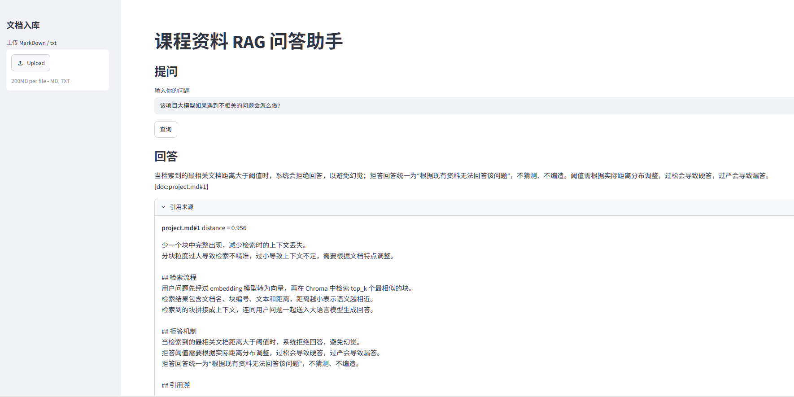
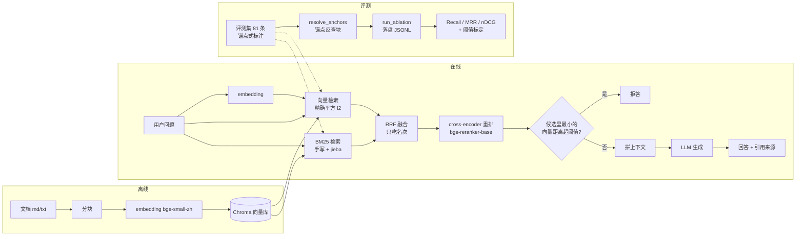

# 课程资料 RAG 问答助手

一个基于本地**混合检索 + 两段式重排**（向量 + BM25 → RRF → cross-encoder）的课程资料问答系统：上传 Markdown/txt，提问后得到**带引用来源**的回答，资料中没有依据时**明确拒答**。

> 技术栈：Python · Chroma · sentence-transformers (bge-small-zh / bge-reranker-base) · jieba · RRF · Streamlit · LLM (DeepSeek/OpenAI)
>
> 语料 884 块 / 评测集 81 条 / 四路检索消融：R@10 0.719 → 0.836 → 0.883 → **0.898**，R@1 0.344 → **0.492** → 0.391 → **0.578**

这个项目的重点不在"能跑通"，而在**能测出差异**：块级评测集 + 四路消融，每一步优化都有数字支撑，反直觉的结果也照实写进[评测](#评测)章。


<!-- 放一张 Streamlit 问答 + 引用展开的截图 -->


---

## 为什么做这个

大模型本身不知道你的课程资料，直接问会编造。RAG 的思路是：**先从你的资料里检索相关段落，再让模型基于这些段落回答**。

但一个可用的 RAG 不是“检索 + 拼 prompt”就完事，还要解决三个问题：

- **检索准不准**：找出来的段落是不是真的相关
- **会不会乱答**：资料里没有的，模型会不会硬编
- **来源可不可信**：回答引用的出处是不是真的存在

这个项目围绕这三点做了检索、拒答和引用溯源，并自建评测集量化效果。

---

## 架构



`Retriever` 是一个 Protocol，不是具体类。目前有四个实现：`VectorRetriever`（精确平方 l2）、`BM25Retriever`（手写 BM25）、`HybridRetriever`（RRF 融合前两者）、`RerankPipeline`（包住任意粗排检索器，用 cross-encoder 重排），由 `retrieval/pipeline.py` 的工厂按 `config.RETRIEVER` 选择。

P2 加 BM25 时这个接缝兑现了：`rag.py` 的生成逻辑和拒答判定一行没改。唯一的改动在拒答门的输入上——融合后 top-1 可能来自 BM25、没有向量分数，所以从 `candidates[0].vector_distance` 改成"候选里最小的向量距离"。这是 bug 修复，不是接口变更。

P3 加重排复用了同一个接缝：`RerankPipeline` 是一个装饰器——构造时接收任意 `Retriever`，`retrieve` 先调它拿候选、再重排。`rag.py` 和 `run_ablation.py` 都不知道重排的存在。

---

## 快速开始

### 1. 安装依赖

```bash
python -m venv venv
source venv/bin/activate        # Windows: venv\Scripts\activate
pip install -r requirements.txt
```


### 2. 下载模型到本地

```bash
hf download BAAI/bge-small-zh-v1.5 --local-dir models/bge-small-zh-v1.5
hf download BAAI/bge-reranker-base --local-dir models/bge-reranker-base
```


> `huggingface-cli` 已废弃，新命令是 `hf`。国内网络慢可先设 `HF_ENDPOINT=https://hf-mirror.com`。
>
> 走镜像时还要加 `HF_HUB_DISABLE_XET=1`：实测 `hf-mirror.com` 不支持 Xet 传输，下载会报 `401 Unauthorized`（`cas-server.xethub.hf.co`）。reranker 约 1.1 GB，下载失败不要重试同一命令，先确认环境变量生效。

### 3. 配置环境变量

复制 `.env.example` 为 `.env`，填入自己的 key：

```.env
LLM_API_KEY=your_api_key_here
LLM_BASE_URL=https://api.deepseek.com/v1
LLM_MODEL=deepseek-chat
```


### 4. 入库

把文档放到 `data/raw/`，然后：

```bash
python ingest.py
```


### 5. 启动界面

```bash
streamlit run app.py
```


### 6. 运行评测

```bash
python eval/anchors.py              # 校验评测集锚点在当前语料上唯一(命中 0 或 >=2 块即报错)
python scripts/compare_bm25.py      # 手写 BM25 与 rank_bm25.BM25Okapi 对拍(需 pip install rank_bm25)
python eval/run_ablation.py         # 跑检索 -> 落盘 JSONL -> 打印指标表
python eval/calibrate_threshold.py  # 拒答阈值标定(扫 TPR/FPR)
python eval/run_eval.py             # 端到端回归(含 LLM 生成,需要 key)
```


------

## 语料

| 来源 | 文档数 | 许可 | 说明 |
| :--- | ---: | :--- | :--- |
| [d2l-zh](https://github.com/d2l-ai/d2l-zh) | 11 | CC BY-SA 4.0 | 《动手学深度学习》中文版选章 |
| [hf-course](https://github.com/huggingface/course) | 20 | Apache-2.0 | Hugging Face NLP 课程中文版 |
| [transformers-zh](https://github.com/huggingface/transformers-docs) | 10 | Apache-2.0 | Transformers 中文文档 |
| 自建笔记 | 3 | — | 课程笔记,保持"课程资料"定位锚点 |

合并后 **44 篇 / 正文 28.8 万字 / 分块 884 块**,语料指纹 `85f63cd9417e`。（块字符总数 31.3 万，比正文多出的部分是标题 breadcrumb 和 overlap 的重复。）

抓取脚本 `scripts/fetch_corpus.py` 只用 raw 直链、零 API 调用(GitHub API 按出口 IP 限流 60 次/小时,实测 21 次探测后必 403),41 个文件全部 pin 到具体 SHA,任何人重跑都得到同一份语料。

开源语料在 `data/raw/fetched/`,`ingest.py` 用 `rglob` 递归收录。**d2l-zh 是 CC BY-SA 4.0(带 share-alike),所以语料文件不提交进仓库**,只提交抓取脚本 —— 克隆后跑 `fetch_corpus.py` 即可复原。

清洗掉六类标记噪音:Notion 锚点 `[[..]]`、`:numref:` 指令、HTML 注释、mdx `import` 语句、独占一行的标签、跨行自闭合 JSX 组件。

清洗是**最容易出静默错误**的一环:规则写错不会报错,只会让文件变小、回答变差,而这两件事都很难归因。所以抓取时加了一条不变量——**只删标记的规则,不该改变代码围栏的奇偶性**:清洗后数一遍 ``` 的个数,奇数就说明某条正则吞掉了正文,直接 `raise`。见踩坑 #7。

---

## 核心设计决策

### 为什么用 bge-small-zh-v1.5？

- 中文优化，检索效果比通用模型好
- 512 维，体积小，CPU 可跑
- 本地推理，免费、离线、可换模型

查询侧加了 bge 要求的指令前缀，文档侧不加，这是模型训练方式决定的，不加会掉召回。

### 为什么手写 BM25，而不是 `pip install rank_bm25`

BM25 是检索岗的必考点，调包等于放弃这块。手写的另一半价值是**可验证**：`scripts/compare_bm25.py` 用同一份语料、同一个分词器、同一组 k1/b/epsilon 跑两套实现，对 10 条边界查询（含空串、纯符号、高频词、生僻词）比对全库分数——最大绝对误差 **3.553e-15**，四个结构量（块数 / avgdl / 词表大小 / 修正前平均 IDF）全部 **0.000e+00**。

对拍逼出了两个不写就永远不知道的细节：

- **IDF 负数怎么处理。** `log((N-df+0.5)/(df+0.5))` 在词出现在过半文档时是负的，会让"查一个高频词"的结果很反直觉。`rank_bm25` 的做法是把负值统一替换成 `0.25 × 平均 IDF`——不照抄这个约定就永远对不上。
- **平均值要取替换负值之前的。** 替换后 `sum(idf.values())` 会变大，拿它去比 `rank_bm25.average_idf` 会差 4e-4——那是比错了量。这个错我第一次就犯了，是脚本告诉我数字不对才回头查的。

分词用 `jieba.cut_for_search`：它对长词会同时吐出长词和子词（"初始化" 同时产出 "初始" 和 "初始化"），召回更高。实测不需要自定义词典，jieba 把连续的 ASCII 字母当整词，RoPE / WordPiece / DistilBERT / Xavier / LSTM 都完整保留。

入库前要清洗 URL 和 markdown 链接：`https://huggingface.co/datasets/billsum` 会把 `https`、`huggingface`、`co`、`datasets` 全塞进词表。实测（旧 1210 块语料）清洗前这四个 token 分别出现在 **147 / 110 / 91 / 58** 个块里，接近停用词（df 越大 IDF 越低）；清洗后降到 **0 / 18 / 7 / 39**，才恢复成有区分度的词。链接文字要保留——`[BillSum](https://…)` 里的 `billsum` 是数据集名，是内容；URL 不是。

### 为什么用 RRF，而不是把两路分数加权求和

l2 距离 ∈ [0, 4] 越小越好，BM25 分数无上界越大越好。直接加权求和要先归一化，而归一化本身是个坑：按全局最大值？按当前查询的 top-20 归一？两路的分数范围随查询剧烈变化（一个查询的 BM25 可能是 0~30，另一个 0~3），任何一组全局参数对这两者都不对。

RRF 只吃名次：`score(d) = Σ_r w_r / (k + rank_r(d))`。名次是两路唯一共有的、量纲无关的信息。

但 RRF 不是免费的，它有明确的偏好：**它奖励"两路都排得靠前"的块，而不是"某一路排第一"的块。** k=60 时 rank 1 = 1/61 = 0.01639，rank 20 = 1/80 = 0.01250，只差 24%——第 1 名和第 20 名的票值几乎一样。所以 RRF 是个**共识机制**，优化"两路都认可"，在召回上等价于"更可能对"，但在 top-1 精度上不保证。

数据完全证实了这一点，见[评测](#四路检索消融)章：hybrid 只在 R@5 / R@10 上领先，R@1 和 R@20 都输给 BM25 单路。

### 为什么重排要用 cross-encoder，而不是再叠一路向量检索

双塔（embedding）把 query 和 doc 分别编码，相似度是点积。这个结构决定了它只能看"话题像不像"，看不到两者之间的交互：

> "Transformer 一共有多少参数" vs. 一段讲 Transformer 结构的文字
>
> 向量距离很近（都在讲 Transformer），但那段文字没有回答参数数量。

这个失败模式在阈值标定里已经量化过：5 条伪相关 OOD 埋在正样本的 p25~p75 区间里，双塔分不开。

Cross-encoder 把 `[query, passage]` 拼成一个序列一起送进 Transformer，每一层 attention 都能让 query 的 token 直接看过 passage 的 token。它对"这段文字回答了这个问题吗"的判断比双塔敏锐得多。

代价是它没有可预先计算的表示：每个 `(query, doc)` 对都要跑一次完整前向，N 个候选就是 N 次。所以只能用在粗排之后的小候选集上——这就是两段式的全部理由：

```
召回   双塔 + BM25 各取 20 → RRF   （便宜、看名次、保证召回）
排序   cross-encoder 精修这 20 个   （贵、看交互、换 top-1 精度）
```

反过来（重排全库 884 块）单查询就是 884 次前向，不可接受。

两个实现细节：

- **输入是裸 `(query, passage)` 对。** bge 的指令前缀只属于 embedding 的查询侧；reranker 的训练分布是裸对，加前缀等于把输入推出分布外。
- **重排不能截断候选。** 拒答门读候选里的最大 rerank 分数（或最小 `vector_distance`，取决于 `GATE_SIGNAL`），一旦重排层把 20 个截成 10 个，被截掉的块不再参与，闸门口径就变了。所以 `retrieve` 返回 `min(k, len(candidates))`，截断统一交给 `rag.py` 的 `FINAL_K`。

实测收益见[评测](#四路检索消融)：R@1 从 0.391 提到 **0.578**，MRR@10 从 0.577 提到 **0.728**；R@20 从 0.922 到 **0.945**，其中一部分来自 COARSE_K 20→30 的更大候选池，不全是重排的功劳。

### 为什么向量检索不再走 Chroma 的 HNSW

一句话：Chroma 1.5.9 的近似检索跨进程不可复现，而消融实验的前提是"数字的变化来自配置，不来自索引抖动"。884 块 × 512 维的暴力检索是毫秒级，没有理由拿可复现性去换延迟。完整诊断和代价见[踩坑 #9](#9-chroma-的-hnsw-跨进程不可复现)。

### 为什么分块带 overlap？

按 300 字符切块，块间重叠 60 字符。固定长度切块会切断句子，overlap 保证跨块语义在至少一个块中完整出现，减少检索时的上下文丢失。

代价是有 60 字符的"歧义区"：落在这里的句子同时属于相邻两块。评测集的锚点标注必须避开它（见踩坑 #8）。

**这套分块后来被数据证明是当前的瓶颈**：64 道有 gold 的题里 11 道 gold 块没进 top-20，其中 6 道目标文档排在前 20 名以内——文档找对了，块找错了。定长窗口不看标题、不看段落边界，切出来的块是"什么都沾一点"的语义平均值。P4 已换成标题感知的结构分块，结果见[评测](#四路检索消融)章。

### 为什么需要拒答？

向量检索**永远会返回 top-K**，哪怕问题跟资料完全无关。如果不判断，LLM 会拿着不相关的段落硬编答案。

所以加了距离阈值：最相关的块距离超过阈值，直接拒答，返回固定话术“根据现有资料无法回答该问题”。

### 为什么要求固定引用格式？

System prompt 要求模型用 `[doc:文件名#块编号]` 标注来源。固定格式有三个好处：

1. 用户能验证答案出处
2. 评测脚本能用正则自动抽取引用
3. 可以校验引用是否真实存在于检索结果中，防止编造来源

### 为什么不用 LangChain？

想理解 RAG 的底层链路：分块、embedding、向量检索、拼上下文。框架会隐藏这些细节，出问题难定位。

------

## 评测

### 评测集：81 条，块级标注

第一版评测集只有 20 条、文件级标注，全 100%——语料只有 10 块时，`top_k=10` 会把整个语料塞进上下文，任何检索优化都测不出来。**测量的分辨率先于优化**，所以重做成了块级。

| 类别 | 数量 | 测什么 |
| :--- | ---: | :--- |
| term-match | 25 | 专有名词/公式直问（"什么是 Xavier 初始化"）——词面匹配的优势区 |
| paraphrase | 21 | 换说法问（"为什么深层网络训练不动了"）——向量的优势区 |
| multi-chunk | 10 | 答案跨 2~3 块，标注全部相关块 |
| partial | 8 | 语料提到但没展开——测"照实说没讲"的边界 |
| ood | 10 | 完全无关（天气、菜谱） |
| ood-adjacent | 4 | 相邻领域（语料里没有的学科） |
| ood-pseudo | 3 | **伪相关**：词面重叠但语料里没有答案 |

拒答题（后三类共 17 条）的 gold 为空，在所有指标里记为 `nan` 而不是 0——`mean()` 跳过 nan，让它们不参与检索指标，只在拒答指标里出现。

### 标签为什么用"锚点"而不是 chunk_id

一条 multi-chunk 标注长这样：

```json
{"id": "c59", "category": "multi-chunk", "query": "多头注意力为什么要分成多个头",
 "anchors": ["我们希望模型可以基于相同的注意力机制学习到不同的行为",
             "最后，将这$h$个注意力汇聚的输出拼接在一起，"],
 "relevant_docs": ["d2l-zh__chapter_attention-mechanisms__multihead-attention.md"]}
```

锚点是目标块内的**唯一短句**，评测时反查"包含该句的块"得到 chunk key。这样换分块策略、chunk_id 全部漂移后评测集依然有效——Phase 4 重切语料时不用重标。硬编码 chunk_id 的话，调一次 chunk_size 就得重标一次，实际上等于不允许调。

代价是锚点必须在全库唯一。884 块靠人眼查不现实，所以写了 `scripts/suggest_anchors.py`：给候选句，报它命中几块、落在哪、偏移多少；撞车时自动扩成"刚好唯一"的最短片段。`eval/anchors.py` 在跑评测前校验全部 81 条，**命中 0 块或 ≥2 块直接抛错**——在边界处响亮失败，好过把 gold 悄悄算错。

### 四路检索消融

`python eval/run_ablation.py`，语料指纹 `85f63cd9417e`（结构分块，884 块），n = 64（有 gold 的题）。BM25 那一行不是凑数——没有它，"hybrid 比 vector 好"证明不了融合有价值，可能只是 BM25 本身比向量强。`hybrid` 和 `hybrid_rerank` 都从同一个 30 块融合池出发；hybrid 直接按融合名次取前 20 评估，hybrid_rerank 把这 30 块重排后取前 20。两行的差分是重排本身，但 R@20 不再是同一个候选集合，见下文的一致性说明。

| 指标 | R@1 | R@3 | R@5 | R@10 | R@20 | MRR@10 | nDCG@10 |
| :--- | ---: | ---: | ---: | ---: | ---: | ---: | ---: |
| vector | 0.344 | 0.516 | 0.586 | 0.719 | 0.758 | 0.482 | 0.531 |
| bm25 | 0.492 | 0.703 | 0.734 | 0.836 | 0.930 | 0.642 | 0.673 |
| hybrid | 0.391 | 0.609 | 0.750 | 0.883 | 0.922 | 0.571 | 0.633 |
| hybrid_rerank | **0.578** | **0.781** | **0.867** | **0.898** | **0.945** | **0.728** | **0.759** |

按类别拆开（**看清 n——8 条题上的 0.05 差距是噪声，不是结论**）：

| 类别 | n | config | R@1 | R@5 | R@10 | R@20 | MRR@10 |
| :--- | ---: | :--- | ---: | ---: | ---: | ---: | ---: |
| term-match | 25 | vector | 0.440 | 0.640 | 0.760 | 0.800 | 0.535 |
| | | bm25 | **0.800** | 0.880 | 0.920 | 1.000 | 0.838 |
| | | hybrid | 0.480 | 0.840 | 1.000 | 1.000 | 0.628 |
| | | hybrid_rerank | 0.760 | **1.000** | **1.000** | **1.000** | **0.861** |
| paraphrase | 21 | vector | 0.381 | 0.667 | 0.810 | 0.810 | 0.520 |
| | | bm25 | 0.333 | 0.762 | 0.857 | **0.952** | 0.506 |
| | | hybrid | 0.429 | **0.857** | **0.905** | 0.905 | 0.588 |
| | | hybrid_rerank | **0.571** | **0.857** | **0.905** | **0.952** | **0.671** |
| multi-chunk | 10 | vector | 0.100 | 0.450 | 0.700 | 0.850 | 0.423 |
| | | bm25 | 0.250 | 0.500 | 0.750 | 0.850 | 0.662 |
| | | hybrid | 0.200 | 0.600 | 0.750 | 0.900 | 0.572 |
| | | hybrid_rerank | **0.300** | **0.750** | **0.750** | **0.950** | **0.700** |
| partial | 8 | vector | 0.250 | 0.375 | 0.375 | 0.375 | 0.292 |
| | | bm25 | 0.250 | 0.500 | 0.625 | **0.750** | 0.362 |
| | | hybrid | 0.250 | 0.375 | 0.625 | **0.750** | 0.349 |
| | | hybrid_rerank | **0.375** | **0.625** | **0.750** | **0.750** | **0.493** |

**COARSE_K=30 之后 R@20 一致性检查要改口径。** hybrid 报的是融合前 20（0.922），hybrid_rerank 是把 30 块重排后取前 20（0.945）。重排可以把融合排名 21~30 的块提上来，所以两行不再要求逐位相同；旧的"必须相同"只在 COARSE_K=20 时成立。要检查重排没截断，看它的输入池是否仍是 30，而不是看 R@20 是否相等。

送进 LLM 的是 `FINAL_K = 10` 块，对应的指标是 R@10。`config.RETRIEVER` 的默认值已切到 hybrid_rerank，代价是每问多约 1.5 秒（30 对 cross-encoder 前向，约 1.5 倍于 20 对；模型首次加载 2.9 s），换来 R@1 +0.187、MRR@10 +0.157。真要在低配机器上跑，把 `RETRIEVER` 设回 `"hybrid"` 也是折中（R@10 0.883）。

**重排把 R@1 从 0.391 提到 0.578，但离 R@20 的 0.945 还差 0.367。** 结构分块 + 扩大候选池把 R@1/R@10 往前推了一截（0.562→0.578、0.891→0.898），5 道旧 hard case 里 c49、c70 已经进了 top-30；c21 仍未进，c68/c69 是标注与提问错位——详见[分块](#一个更值钱的发现分块在杀死检索)和[阈值](#拒答阈值标定)。

paraphrase 的 vector R@1 只有 0.381 但 R@20 高达 0.810——向量**找得到**这些块，排序很差；重排把 R@1 扶到 0.571，正好印证这个诊断。multi-chunk 的 R@1 始终最低（0.100~0.300）是意料之中：答案本来就散在 2~3 块里，指望第一块就命中不现实，该看 R@10（hybrid_rerank 0.750）。这一档比 COARSE_K=20 时的 0.800 低，可能是一题移位，n=10，只当方向性信号。

partial 的融合截断被 COARSE_K=30 补上了：BM25、hybrid、hybrid_rerank 的 R@20 都是 0.750（COARSE_K=20 时 hybrid 只有 0.625）。R@1 仍只有 0.375，说明池子里有 gold 但排序不好；n=8，只当方向性信号。

### 融合赢了中段，输了 top-1 和 R@20

新语料上 BM25 单路在 R@1（0.492 vs 0.391）、R@3（0.703 vs 0.609）、R@20（0.930 vs 0.922）和 MRR@10（0.642 vs 0.571）上都赢 hybrid；hybrid 只在 R@5（0.750 vs 0.734）和 R@10（0.883 vs 0.836）上领先。旧语料是"融合赢召回、输 top-1"，结构分块之后 BM25 的深召回优势变大，融合截断到 20 块时反而挤掉 BM25 找到的 gold。

先排除实现问题：两路各取 30，并集平均 39.2 块（最少 30、最多 45），符合预期；hybrid 的 top-1 有 43/81 与 BM25 的 top-1 相同——不是"融合把 BM25 的结果丢了"。

这是 RRF 的结构性后果。k=60 时，一个被 BM25 排第 1、被向量排第 20 的块得分 1/61 + 1/80 = 0.02889；一个两路都只排第 5 的块得分 2/65 = 0.03077——**共识块直接反超单路第一名**。RRF 优化的是"两路都认可"，在 R@5 / R@10 上有效，但在 top-1 和深召回上不是。

按类别看：

- **paraphrase（向量优势区）**：hybrid 的 R@1 / R@5 是 0.429 / 0.857，重排后 0.571 / 0.857；重排主要修 R@1。
- **term-match（BM25 优势区）**：BM25 R@1 = 0.800，hybrid 只有 0.480——融合把 BM25 精准的 top-1 稀释掉了。hybrid 的 R@20 = 1.000，gold 全在候选池里；重排把 R@1 拉回 0.760，仍略低于 BM25 的 0.800。

**结论：RRF 适合当召回层，不适合当排序层，但它截断到 20 块时会损失 BM25 的深召回。** 当前做法是"融合拿 30 块候选池，再用交叉编码器重排"；hybrid_rerank 的 R@1 0.578、MRR@10 0.728，超过 BM25 单路的 0.492 / 0.642，R@20 0.945 也反超 BM25 的 0.930。COARSE_K=30 基本补上了融合截断——partial 的 R@20 从 0.625 回到 0.750。

旧语料上试过用权重救：把向量权重压到 0.3，hybrid 的 R@1 从 0.375 回到 0.453、MRR 从 0.556 到 0.630，仍未过 BM25 单路的 0.484 / 0.648；而且这组权重是在同一份评测集上选的，等于拿测试集调参。`config.RRF_WEIGHTS` 保留等权 (1.0, 1.0)，理由写在注释里。新语料没有重跑这组权重实验。

### 评测集的词面偏置：BM25 的数字被高估了

口径：查询 token 与 gold 块 token 的交集中，至少有一个词在全库 df ≤ 50（即不是"的""是""模型"这类高频词）；df 在当时的 1210 块语料上算（结构分块后未重算）。

| 类别 | n | 有 df≤50 共享词 |
| :--- | ---: | ---: |
| term-match | 25 | 92.0% |
| paraphrase | 21 | **85.7%** |
| multi-chunk | 10 | 100% |
| partial | 8 | 100% |
| **合计** | 64 | **92.2%** |

只有 5 条题（c19 / c21 / c38 / c40 / c55）与 gold 没有任何低频词重叠。

这说明：**连"改写题"这一档，绝大多数问句都带着 gold 块里的原词。** 一部分是技术术语不可避免（问 ReLU 当然会出现 `relu`），但整体上，这份评测集测的是"词面 + 语义"，不是纯语义。BM25 的绝对数字因此被高估——换一份真正改写过的评测集，BM25 会掉，hybrid 的相对位置会好于现在。

**但那 5 条无重叠的题给了方向性的证据**（n=5，只当信号看不当结论）：gold 块进 top-20 的条数，vector 5/5、hybrid 4/5、**BM25 只有 2/5**。完全没有词面重叠时，词法信号就废了——两路的互补性是真实的，只是被评测集的偏置盖住了。

所以 README 里所有"BM25 比 X 好"的结论都该带着这个折扣读。这也是[局限](#局限)里"没有 holdout、评测集同源"的具体表现。

### 拒答阈值标定

线上闸门读**候选里最大的 rerank 分数**（`config.GATE_SIGNAL = "rerank"`），低于 `RERANK_THRESHOLD` 就拒答。标定脚本与线上共用同一口径：`python eval/calibrate_threshold.py`。

正样本 = gold 进了 top-30 的 61 题，负样本 = 17 条 OOD；闸门输入取候选里最大的 rerank 分数（不是 gold 块自己的分数——闸门只管"在不在射程内"，排序对错由检索指标负责）。误拒 = 该答的题被卡掉，误答 = 不该答的题放进来。

在 884 块结构分块语料（指纹 `85f63cd9417e`）、COARSE_K=30 上：

| 阈值 | 误拒 /61 | 误答 /17 | J |
| ---: | ---: | ---: | ---: |
| 0.45（旧语料标定值） | 4 | 4 | 0.699 |
| **0.16（现行）** | **2** | **4** | **0.732** |
| 0.05 | 0 | 5 | 0.706 |

0.16 落在正样本的一段无样本间隙 `(0.0896, 0.2166)` 里，阈值取这段中任何值结果相同。和 0.45 相比，误答没有增加，误拒从 4 条降到 2 条——被救回来的是 c67（LSH 注意力，0.2166）和 c25（位置信息/训练稳定性，0.4013）。再降到 0.05 会多放行 c79（Rust 借用检查，0.1028），用 1 条误答换 2 条误拒，J 反而下降。

剩下 2 条误拒是 c24（注意力和 FFN，0.0844）和 c12（LSTM 用在哪里，0.0896）。剩下 4 条误答分数都在 0.75 以上：c80（Transformer 参数，0.752）、c34（梯度不更新，0.824）、c77（SQL 分组，0.958）、c33（dropout 率，0.996）。要把它们全挡住得把阈值抬到 0.76 以上，误拒会涨到 11 条以上，不划算。c33 的 top-1 真写着"暂退概率设为 0.2 和 0.5"，更像标注口径问题；c77 是 reranker 自己的失败（它给"从词汇表裁剪 token"的段落打了 0.958，单独复算过）；c34/c80 是问题本身含糊或语料只沾边。

c80 值得单独记：旧 1210 块语料上它的 rerank 只有 0.354，结构分块后升到 0.752。**换分块方案会让闸门分布移动，阈值必须重标。**

此前用的是向量距离闸门（`DISTANCE_THRESHOLD = 0.90`）。在旧语料上它误拒 7/59、误答 5/17；根因是 embedding 距离量的是"话题相关"不是"能不能回答"——"语料在讲 Transformer"和"语料讲了 Transformer 有多少参数"在双塔向量里几乎一样。0.90 和配置里那段注释的误拒/误答数字都来自旧 1210 块语料，当前 884 块语料尚未重标；它只在 `GATE_SIGNAL="vector"` 时生效，切回去之前必须用 `--signal vector` 重跑。

**实现状态**：`rag.py._should_refuse` 在 `GATE_SIGNAL="rerank"` 时读候选里最大的 rerank 分数，在 `"vector"` 时读最小向量距离；`calibrate_threshold.py --signal` 与线上共用同一套 `accepts()`。信号与检索器不配套（rerank 配 `hybrid`，或 vector 配 `bm25`）会直接抛错，不会静默退回另一种闸门。

另一条路更彻底：放弃单一阈值，改成生成侧的"资料没讲"判断。两条不冲突，可以后做。

### 按块过滤：闸门线不等于每块线

P4 的最后一项。`rag.py` 在闸门放行后不再无条件取前 `FINAL_K` 块，而是只保留 `rerank_score >= CONTEXT_MIN_RERANK` 的块。

不能直接复用 `RERANK_THRESHOLD = 0.16`：闸门线是"候选里最好的证据"，0.16 会筛掉 c46（0.041）、c71（0.119）这些真有 gold 的块。在 62 道闸门放行的题上量了一下：

| 逐块下限 | 保留 gold | 上下文块数 |
| ---: | ---: | ---: |
| 不筛 | 61/61 | 620 |
| **0.02（现行）** | **61/61** | **498（-20%）** |
| 0.05 | 61/61 | 458（-26%） |
| 0.16 | 60/61 | 387（-38%） |

0.02 没有丢掉任何 gold 块；0.16 才会丢掉 c62 的第二块 gold。它在个别题上会明显缩短上下文：c71"Reformer 具体怎么实现的"从 10 块降到 3 块（第 4 块起分数 ≤0.008）；c46"为什么用小批量比单个样本稳"保持 10 块（最低 0.047）。

向量闸门下不启用逐块过滤：没有逐块相关性标定，按距离筛会丢掉 BM25 单独召回的块（`vector_distance=None`）。

### 查询改写实验：负结果

P5 试过给每条 query 生成一个检索式改写，原 query 和改写各检索一次，在 hybrid 层做 RRF，再统一 rerank。改写缓存落盘，保证重跑可复现。

在 COARSE_K=20 下跑官方消融：基线 R@10 0.891 / R@20 0.906 / MRR 0.712，改写版 0.883 / 0.898 / 0.712。paraphrase 的 R@10 从 0.905 涨到 0.952，但 partial 的 R@3/R@5/R@10/R@20 从 0.625 全掉到 0.500，multi-chunk 的 R@20 也掉了 0.05。逐题看只有三条变化：c21 被捞回，c62 丢半块 gold，c71 的 gold 从第 3 掉出 top-10。

原因是 RRF 的共识机制：改写路带回一批泛化块，原 query 唯一命中的 gold 只拿到一路的分，被两路都出现的通用块反超。

把融合后的完整并集（平均约 28 块）都交给 reranker 后，改写版在 COARSE_K=30 下能到 R@10 0.922、R@20 0.938；但同一份语料上不改写、只把 COARSE_K 提到 30 就有 R@10 0.898、R@20 0.945。改写只在 paraphrase 上明显更好（R@10 1.000 vs 0.905），代价是多一次 LLM 调用和双倍混合检索，还丢了 partial（R@20 0.625 vs 0.750）。

**结论：查询改写不进默认链路。** 代码和 `hybrid_rerank_rewrite` 配置保留为实验，用于复现负结果；`COARSE_K=30` 才是这次实验里真正便宜的收益。

### 引用校验：引用都落地了，但不等于忠实

运行时在 `rag.answer` 返回前解析 `[doc:文件名#chunk_id]`，和本次送进 LLM 的 `sources` 比对；`STRICT_CITATION=True` 时没有有效引用就返回标准拒答，否则 `app.py` 只给出警告。离线用 `eval/eval_faithfulness.py` 跑 81 条（严格模式前的一组）：

| 指标 | 数值 |
| :--- | ---: |
| citation precision | 202/202 = 1.000 |
| citation coverage | 65/66 = 0.985 |
| no-citation | 1/66 = 0.015 |
| invalid-citation | 0/66 = 0.000 |

81 条里回答 66、拒答 15（4 条 OOD 误答 + 2 条正常题误拒）。没有引用的是 c80（"Transformer 一共有多少参数"，OOD 伪相关），它本来就不该被回答；严格模式会把这类回答直接改成拒答。

**这不是语义忠实度**：precision 1.000 只说明引用的块真实存在于上下文，不说明这句话被块支持。下面的 10 条抽样里，h13/h14 的引用全部合法，却都说"资料没有讲"——真实原因是对应的 gold 块没进 top-10 上下文，引用校验抓不到这种"证据没给全"。要测这一层，需要人工或 LLM judge；P6 目前只到引用落地 + 抽样审计。

### holdout：20 条没参与调参的题

从 dev 评测没用过的 20 篇文档里新写了 20 条题（16 条有 gold + 4 条 OOD），锚点仍然用短句；这 20 条不参与任何阈值或参数选择。最终配置（hybrid_rerank / COARSE_K=30 / 闸门 0.16 / 逐块 0.02）跑一次：

| 指标 | dev（n=64） | holdout（n=16） |
| :--- | ---: | ---: |
| R@1 | 0.578 | 0.667 |
| R@3 | 0.781 | 0.917 |
| R@5 | 0.867 | 0.938 |
| R@10 | 0.898 | 0.938 |
| R@20 | 0.945 | 0.938 |
| MRR@10 | 0.728 | 0.846 |
| nDCG@10 | 0.759 | 0.853 |

holdout 数字更高，**但不能读成"泛化更好"**：n=16，一道题就是 0.0625；这些题是看着原文锚点写的，词面偏置比 dev 更强。它的用途是检查最终配置有没有崩，不是估绝对性能。按类别：paraphrase 5 题 R@1=1.000，multi-chunk 3 题 R@1=0.222，term-match 6 题 R@1=0.667，partial 2 题 R@1=0.500——小样本只看方向。

引用校验在 holdout 上跑了两轮（同一份 20 条、同一配置，LLM 输出有随机性）：

| 模式 | 回答/拒答 | precision | coverage | no-citation |
| :--- | ---: | ---: | ---: | ---: |
| 仅警告 | 17/3 | 41/41=1.000 | 15/17=0.882 | 2/17 |
| **严格（无有效引用即拒答）** | **16/4** | **39/39=1.000** | **16/16=1.000** | **0/16** |

严格模式保证了"展示出来的回答至少带一个有效引用"，但没有解决"引用合法但答不了"：h17（Excel）这轮带了一个有效引用被回答，h19（DataLoader）反而因为模型漏引用被拒。两轮的引用条数也明显变化（h01 3→4、h11 6→2），说明 **no-citation 不是稳定的越界检测器**；严格模式是安全网，不是拒答策略的替代。

### 语义忠实度抽样（10 条）

从 dev 和 holdout 各抽 5 条（不是随机：覆盖正常题、弱标注题、OOD 误答、多块题），逐条看引用块是否支持回答：

| 结论 | 条数 | 例子 |
| :--- | ---: | :--- |
| 引用块支持结论 | 5 | c01 / c33 / c68 / c69 / h12 |
| 正确拒答（h17 引用块偏弱） | 2 | h15 / h17 |
| 合理推断但略超出原文 | 1 | c46 |
| "资料没讲"但其实 gold 块在库里、只是没进上下文 | 2 | h13 / h14 |

h13（三种 tokenizer 的预分词器）的 WordPiece gold 块 `chapter6__8#11` 没进 kept；h14（三种 tokenizer 的 normalizer）的 XLNet gold 块 `chapter6__8#34` 也没进。两条回答都引用了其他合法块，然后说"资料没有给出"——语义上是对当前上下文的诚实回答，但对整个语料是错的。对应的指标信号是 holdout multi-chunk R@10 = 0.667。

10 条里没有发现凭空编造具体事实的案例。主要失败模式不是"模型看了 gold 还乱说"，而是"gold 没进最终 10 块上下文"。所以下一步如果继续做忠实度，优先补多块题的上下文召回，而不是加 LLM judge。

### 一个更值钱的发现：分块在杀死检索

只看向量路：64 道有 gold 的题里，11 道（17.2%）的 gold 块**完全没进 top-20**。融合之后降到 **5 道**（c21 / c49 / c68 / c69 / c70）——混合检索补上了一半，在旧 fixed 分块下这 5 道哪种检索都救不回来。**问题不在排序，在块本身。**

先看向量路里最有说服力的 6 道：目标文档排得非常靠前，块却找不到（下表是 vector 的名次）：

| 题 | gold 块排名 | 该文档**首次**出现的排名 |
| :--- | ---: | ---: |
| c70 BillSum 数据集 | 31 | **1** |
| c69 T5 模型结构 | 672 | **3** |
| c68 DistilBERT | 541 | **12** |
| c47 为什么随机初始化权重 | 44 | **1** |
| c49 注意力掩码 | 44 | 20 |
| c71 Reformer | 54 | 54 |

**文档找对了，块找错了。** 向量检索明明知道该看哪一篇（甚至排第 1），却定位不到具体那一段。这指向 `chunker.py` 的定长切片——300 字符的固定窗口不看标题、不看段落边界，切出来的块是一个"什么都沾一点"的语义平均值，和精确提问对不上。

这比旧 fixed 语料上 "R@20 = 0.789" 这类聚合数字有力得多：它指明了下一次优化的方向是**分块**而不是检索。

另一类问题在自建笔记上：c10/c11/c12/c17/c27 的目标是 `nn.md`（3 块）、`transformer.md`（4 块）、`project.md`（3 块）。问 "ResNet 是什么"，`nn.md` 的三块排到第 79 / 201 / 985 名——300 字的笔记摘要块在教材正文里被淹没（名次是旧 fixed 分块、1210 块下的）。

**P4 重跑结果（结构分块，884 块，指纹 `85f63cd9417e`）**：c49 被捞回（BM25 第 2、rerank 第 3）；c21 反而掉出候选池（新块向量距离 1.0410，top-20 截止 0.9816）；c70 仍被融合截断，rerank 只给 0.203；c68/c69 的锚点只提到模型名，没有回答所问的区别/结构。所以"分块是唯一瓶颈"要修正为：分块改善了 top-1/top-10，但深召回缺口里混着融合截断和标注问题。

### 附录：指标口径

- **R@K 是覆盖率不是二值命中**：3 个 gold 块里命中 2 个记 2/3，不是 1。
- **拒答题在检索指标里是 nan 不是 0**：否则"拒答正确"会被记成"检索失败"。
- **跨语料指纹的数字不可比**：`corpus_tag` 是对全库 `(key, text)` 取 sha256 的前 12 位。抓取脚本改一行、chunk_size 调一次，指纹就变，旧数字全部作废。报告里两者必须一起出现。

------

## 踩坑与优化

### 1. 相对路径导致静默查空库

**问题**：`CHROMA_PATH = "data/chroma"` 是相对路径。从 `eval/` 目录运行时，实际打开的是 `eval/data/chroma`——一个被 Chroma 自动创建的空库。查询返回空结果，但不报任何错，评测全部 0%，却看不出原因。

**修复**：所有项目内路径锚定 `Path(__file__)`：

```
BASE_DIR = Path(__file__).resolve().parent
CHROMA_PATH = str(BASE_DIR / "data" / "chroma")
```


并在评测脚本开头加空库检查，把静默失败变成显式报错：

```
if collection.count() == 0:
    print("错误: Chroma 集合为空, 请先运行 python ingest.py")
    sys.exit(1)
```


### 2. 距离阈值误拒相关问题

**问题**：初版阈值 1.0，实测相关问题 top-1 距离在 0.52~1.14，无关问题在 1.14~1.36。1.0 把 5 个相关问题挡在 LLM 门外，直接拒答。

**修复**：阈值改为 1.15，相关问题全部放行，无关问题靠 system prompt 的拒答规则兜底。

> 这个 1.15 后来被推翻了。语料从 10 块扩到 1210 块后重标，它在 17 条拒答题上放行了 13 条。详见[评测](#拒答阈值标定)章——**在旧语料上标定的参数，换语料后必须重标，不能继承。**

### 3. TOP_K 太小，正确块进不了上下文

**问题**：ResNet、LSTM 的答案在 `nn.md` 的同一个块里，但向量检索时该块排在 top-5 之外，LLM 拿不到答案。文件级 Recall 命中（`nn.md` 在 top-5），但块级没命中。

**修复**：`TOP_K` 从 5 提到 10，正确块进上下文，回答正常。

**这也暴露了指标局限**：文件级 Recall 无法反映“命中的块对不对”。后续可标注 chunk 级别做更细的评测。

### 4. `retrieve` 忽略 `top_k` 参数

**问题**：`retrieve(query, top_k=5)` 里，`collection.query` 硬编码用了 `TOP_K`，传参无效。

**修复**：`n_results=top_k`，让参数真正生效。

> #3 和 #4 里的 `TOP_K`、`retrieve()` 在 P1 重构时已经拆掉了：`TOP_K` 变成 `COARSE_K`（粗排候选数）和 `FINAL_K`（送进 LLM 的块数）两个旋钮，检索逻辑搬进了 `retrieval/`。这里保留原文是因为**踩坑本身有价值**——#3 是"文件级指标掩盖了块级失败"的第一个证据，#4 是"参数传了但没生效"的典型。但别去代码里找 `TOP_K` 了。

### 5. 校验器只检查了第一条——静默通过最危险

**问题**：`eval/anchors.py` 里 `validate()` 的 `return errors` 缩进在 `for` 循环内部，检查完第一条就返回。调用方拿到空列表，解读为"全部 81 条锚点都没问题"，实际上只校验了 1 条。

**修复**：取消缩进。用"在第 2 位和最后一位注入一个错误锚点"验证修复——两处都被抓到才算真的修好。

**教训**：这个 bug 不会崩、不会报错、不会让任何一个数字变得离谱，它只是让**一份本该失败的校验静默通过**。这类 bug 比崩溃难发现一个数量级。所以校验代码自己也需要被测试——"校验通过了"这句话要能拿出证据。

### 6. `glob("*")` 漏掉子目录，入库静默少十几篇文档

**问题**：`ingest_all()` 用 `data/raw/glob("*")` 找文档，但开源语料抓在 `data/raw/fetched/` 子目录里。`glob` 不递归，而 `fetched` 是个没有 `.md` 后缀的目录，在两个检查点上都被跳过——不报错，只是库里的文档少了。

**修复**：改用 `rglob("*")`，并按文件名排序保证入库顺序确定（块 id 不随文件系统枚举顺序漂移）。

### 7. 清洗正则吃掉整段正文

**问题**：为删掉跨行的 `<Question ... />` JSX 组件写了 `^[ \t]*<[A-Za-z][\w.-]*\b.*?/>[ \t]*$` 配 `DOTALL`。正文里独占一行的 `<a href="...">` 会成为匹配起点，然后懒匹配一路扫到很远的下一个 `/>`，把中间的代码块整段带走。

**症状**：hf-course 从 172 KB 掉到 141 KB，且**没有任何报错**——文件写进去了，只是内容少了。

**修复**：在结束引号前加 `[^>\n]*\n`，要求开始标签不在同一行闭合。

**更有价值的修复是那道守卫**：清洗后数一遍 ``` 的个数，**奇数就说明某条规则吞掉了正文**（代码围栏必然成对）。这个奇偶校验在 `fetch_corpus.py` 里直接 `raise`。

需要说清楚的是：**这个 bug 是靠肉眼看文件体积不对发现的**（172 KB → 141 KB），不是靠守卫——守卫是修完之后才加的。体积异常是个很弱的信号，得先知道原文件多大才看得出来，而清洗规则改动频繁，没人记得住每个文件该多大。守卫把"感觉体积不太对"换成了一条明确的断言：**只删标记的规则不该改变代码围栏的奇偶性**。下次同类的正则错误会在抓取阶段就炸，而不是等到入库以后发现回答变差。

### 8. 评测锚点跨在 chunk overlap 边界上

**问题**：`chunk i` 覆盖 `[240i, 240i+300)`，相邻块重叠 60 字符。锚点落在这 60 字符里时会同时命中两块，`resolve_anchors` 判定为歧义。

**修复**：不手算安全区，直接对全库实测唯一性。理论上的安全区 `[overlap, chunk_size - overlap)` 只用来提示"往哪儿找"，判定标准始终是"全库实测只有一块包含它"——因为跨文档撞车、重复段落这些情况算不出来，只能测。

顺带发现一个更隐蔽的：撞车的锚点需要**扩成刚好唯一的最短片段**，但第一版 `minimal_unique` 用"当前只命中一块"当守卫——等于要求它先别撞车才肯帮忙修撞车，于是每次都直接返回 `None`。基准块必须由调用方显式指定。

### 9. Chroma 的 HNSW 跨进程不可复现

**问题**：写 P2 消融时发现同一条命令跑两遍，向量基线的 R@10 从 0.703 变成 0.688。一开始怀疑是代码改动，逐条比对才确认：同一份语料、同一份索引文件、同一个脚本，连跑三次，top-20 的集合在 **23/81** 条题上不同。差异随深度放大：

| top-k | 有差异的题 |
| ---: | ---: |
| 1 | 0/81 |
| 3 | 1/81 |
| 5 | 3/81 |
| 10 | 8/81 |
| 20 | 23/81 |

这是 ANN 的典型长尾误差：近似检索不保证精确的近邻集合，只保证大概率接近。对 demo 无所谓，对"用数据说话"的消融是致命的——两次运行的指标差分不清是配置变了还是索引抖了。

具体到一条题：`c20` 的 gold `nn.md#1` 在精确检索里稳定排第 11。ANN 有时会漏掉另一个块（`hf-course__chapter6__5.md#2`，真实距离排名第 7），于是 `nn.md#1` 被顶到第 10——R@10 白捡一个命中。那个 0.703 就是这么来的，不是检索变好了。

**修复**：`retrieval/vector.py` 改成进程内精确平方 l2 检索——构造时把全库 embedding 拉成 float64 矩阵，查询时 `((emb - q) ** 2).sum(axis=1)` 全量算，`np.argsort(kind="stable")` 取前 k。

代价和边界：

- **内存**：884 × 512 × 8B ≈ 3.6 MB，可忽略。块数上万时是 400 MB 量级，那时该换回 ANN 或分片——这是拿延迟换可复现性的边界。
- **新鲜度**：embedding 是构造时的快照。重跑 `ingest.py` 之后必须重建检索器；旧实现每次 query 都问 Chroma，不会有这个问题。这是拿"永远与库同步"换"结果可复现"，在评测场景里这笔交易划算。
- **稳定性**：`np.argsort` 默认 quicksort 不稳定，同一份输入在并列处可能给出不同名次。显式指定 `kind="stable"`。
- **距离口径**：Chroma 的 `"l2"` 空间返回的是**平方** l2，不是开方后的 l2。0.90 的阈值是在这个返回值上标的，所以精确检索也必须报平方值——开方后值域从 [0, 4] 变成 [0, 2]，阈值整个作废。

修复后连跑两次完整 ablation，逐题结果哈希一致（vector `85e9e6e0...` ×2，hybrid `8f239418...` ×2），指标逐位相同。

------

## 项目结构

```text
course-rag/
├── app.py                      # Streamlit 界面
├── config.py                   # 全部实验旋钮集中于此(ablation 可复现的前提)
├── db.py                       # Chroma client + collection(单独成模块,
│                               #   否则 import ingest 就会触发建库副作用)
├── ingest.py                   # 文档入库
├── chunker.py                  # 分块
├── embedder.py                 # embedding 封装
├── llm.py                      # LLM 客户端
├── rag.py                      # 检索 + 拒答 + 生成
├── retrieval/                  # 检索器抽象层,后续所有模块的接缝
│   ├── base.py                 #   ScoredChunk 数据结构 + Retriever Protocol
│   ├── vector.py               #   向量检索(进程内精确平方 l2)
│   ├── bm25.py                 #   手写 BM25 + jieba 分词
│   ├── fusion.py               #   RRF 融合(只吃名次)
│   ├── hybrid.py               #   向量 + BM25 双路
│   ├── rerank.py               #   cross-encoder 两段式重排
│   ├── rewrite.py              #   查询改写实验(原 query + 改写 RRF,默认不启用)
│   └── pipeline.py             #   工厂:按 config.RETRIEVER 选实现
├── eval/
│   ├── anchors.py              # 锚点加载/校验/解析(命中 0 或 >=2 块即报错)
│   ├── eval_set_chunks.jsonl   # 评测集 81 条
│   ├── holdout.jsonl           # 20 条未参与调参的 holdout
│   ├── metrics.py              # Recall / MRR / nDCG
│   ├── run_ablation.py         # 跑检索 -> 落盘 JSONL -> 打指标表
│   ├── calibrate_threshold.py  # 拒答阈值标定(TPR/FPR 扫描)
│   ├── eval_faithfulness.py    # 引用校验/覆盖率评估
│   ├── run_eval.py             # 端到端回归(含 LLM)
│   └── results/                # 落盘结果(不入库 git)
├── scripts/
│   ├── fetch_corpus.py         # 抓取开源语料(纯 raw 直链 + pin SHA)
│   ├── compare_bm25.py         # 手写 BM25 与 rank_bm25 对拍(误差 3.553e-15)
│   ├── build_rewrites.py       # 预生成查询改写缓存
│   └── suggest_anchors.py      # 扩评测集时的锚点辅助工具
├── data/
│   ├── raw/                    # 自建笔记
│   │   └── fetched/            # 抓取的开源语料(不入库 git,CC BY-SA)
│   └── chroma/                 # 向量库(不入库 git)
├── models/                     # 本地模型(bge-small-zh + bge-reranker-base,不入库 git)
├── docs/
│   └── demo.png
├── requirements.txt
└── README.md
```

**`ScoredChunk` 是后续所有阶段的共同数据格式**——同一个对象上挂 `vector_distance` / `bm25_score` / `fusion_score` / `rerank_score` 四个分数，每个检索器只填自己那一个。这样加一路检索器不用改调用方，也天然避免了"把三种不同尺度的分数直接相加"这个经典错误：RRF 只吃名次，拒绝门只看 `vector_distance`。


------

## 路线图

主线是**检索效果**，每一步都拿上一阶段的评测数据说话。

| 阶段 | 内容 | 状态 |
| :--- | :--- | :--- |
| P1 | 语料扩充到 1210 块 / 块级评测集 81 条 / 检索器抽象层 / 向量基线 | ✅ |
| — | 拒答阈值重标定 | ✅ |
| P2 | 手写 BM25 + RRF 混合检索，与 `rank_bm25` 对拍 | ✅ |
| P3 | bge-reranker-base 两段式重排 + rerank 分数闸门 | ✅ |
| P4 | 结构感知分块 + 幂等入库 + 按块过滤 | ✅ |
| P5 | 查询改写（实验过，未采用）+ 多轮对话（可砍） | ⬜ |
| P6 | 运行时引用校验 ✅ + 语义忠实度评估 ⬜ | 🟡 进行中 |
| P7 | 终期报告、holdout 集跑一次 | ✅ |

每个阶段产出一组 ablation 数字：vector → +bm25 → +hybrid → +hybrid+rerank。**数字反过来也照实写进 README**——那才是实验。

八条从数据里长出来的具体任务，不是泛泛的"优化"：

- **重排（已完成）**：hybrid 的 R@20 = 0.922 但 R@1 只有 0.391。接上 cross-encoder 后 R@1 到 0.578；R@20 从 0.922 到 0.945，其中一部分来自 COARSE_K=30 的更大候选池。剩下的缺口换到了分块、融合和多块题。
- **分块（P4 已完成）**：结构分块把 1210 个定长块换成 884 个标题段块，hybrid_rerank 的 R@1 0.531→0.578、R@10 0.883→0.898，R@20 0.945。5 道旧 hard case 里 c49、c70 进了 top-30；c21 仍没进（新块向量距离 1.0410），c68/c69 的锚点只提到模型名、没回答所问内容。详见[分块](#一个更值钱的发现分块在杀死检索)章。
- **闸门（已完成）**：rerank 分数闸门 0.16 在 884 块语料上误拒 2/61、误答 4/17；剩下 4 条误答分数都在 0.75 以上，不是阈值能解决的。详见[拒答阈值标定](#拒答阈值标定)。
- **按块过滤（已完成）**：逐块下限 0.02，在 62 道闸门放行的题上保留 61/61 个 gold 块，上下文块数 -20%；不能复用闸门线 0.16。详见[按块过滤](#按块过滤闸门线不等于每块线)章。
- **查询改写（实验过，未采用）**：完整并集 rerank 在 paraphrase 上 R@10 1.000 vs 0.905，但 partial/multi-chunk 掉，且 COARSE_K=30 单独就能拿到大部分收益。详见[查询改写实验](#查询改写实验负结果)章。
- **引用校验（确定性部分已完成）**：dev 202/202 引用合法；严格模式下 holdout 16/16 回答都带有效引用，但 h17 证明引用合法不等于能回答。语义忠实度未测。详见[引用校验](#引用校验引用都落地了但不等于忠实)章。
- **holdout（已完成）**：20 条未参与调参的题（16 条有 gold + 4 条 OOD），最终配置 R@1 0.667、R@10 0.938；样本小且题目看着锚点写，只当 sanity check。详见[holdout](#holdout20-条没参与调参的题)章。
- **语义忠实度抽样（10 条）**：5 条支持、2 条正确拒答、1 条轻推断、2 条因 gold 没进上下文而说"资料没讲"；没有发现凭空编造。详见[抽样](#语义忠实度抽样10-条)章。

------

## 局限

诚实列出还没解决的：

- **拒答挡不住伪相关题**。rerank 闸门 0.16 下误答 4/17、误拒 2/61；剩下 4 条误答是 c33 / c34 / c77 / c80，分数都在 0.75 以上，挡住它们要抬到 0.76 以上、误拒涨到 11 条以上。根因是 cross-encoder 对"提到 entity"和"回答该问题"仍然分不开，外加 c33 更像标注口径问题。
- **OOD 样本只有 17 条**，FPR 的 95% Wilson 区间约 [0.096, 0.473]——真实误答率可能比点估计 23.5% 高得多，也可能低得多。这个区间宽度决定了阈值只能定到"量级正确"。
- **评测集的词面偏置高估了 BM25**。92.2% 的题与 gold 共享低频词，连 paraphrase 档也有 85.7%。BM25 的绝对数字因此偏乐观，跨数据集不可直接引用。
- **hybrid 的 top-1 问题由重排补上了，但重排不是免费的**。hybrid 单用 R@1 = 0.391，不如 BM25 单路；加 reranker 后到 0.578，反超。代价是每问多约 1.5 秒和 1.1 GB 模型（本机实测）。低配环境可以只跑 hybrid，R@10 也还有 0.883。
- **partial 的融合截断被 COARSE_K=30 补上了**。BM25、hybrid、hybrid_rerank 的 R@20 都是 0.750（COARSE_K=20 时 hybrid 只有 0.625）；但 R@1 仍只有 0.375，池子里有 gold、排序不好。n=8，只当方向性信号。
- **融合单用仍然输给 BM25 的 R@20**。BM25 单路 R@20 = 0.930 > hybrid 的 0.922；重排 30 块后 hybrid_rerank 到 0.945 才反超。代价是每问多跑 10 对 cross-encoder（20→30），检索耗时约 1.5 倍。
- **结构分块牺牲了 multi-chunk 的上下文**。这一档 R@10 从 0.900 掉到 0.750、nDCG 0.853→0.646（n=10，可能是一题移位）。按节切块会让跨小节的答案被拆开，后续可以试合并相邻小节。
- **精确检索有规模上限**。当前 884 块全量计算是毫秒级；块数上万后内存到数百 MB、单次查询到几十毫秒，那时必须换回 ANN 或分层索引。这是有意做的一笔交易，边界写在这里。
- **分块仍有粒度问题**。结构分块修掉了"文档对、块不对"的一部分问题，但 c21 这类答案落在长块尾部的题反而被稀释；多块题也因为按节切分丢了跨小节上下文。按块过滤（0.02）做了，但它只去掉极弱块，救不了块内稀释。
- **自建笔记被开源语料淹没**。几块的小文档在 884 块里排到几百名。目前把两类语料混在一起报指标，掩盖了这个问题，应该分开列。
- **引用校验只到"落地"，没到"忠实"**。202/202 引用合法，但 c68/c69 说明"引用真实块"不等于"块支持结论"；语义忠实度需要 LLM judge 或人工标注。
- **严格引用模式只保证引用存在，不保证回答正确**。无有效引用即拒答能过滤 c80/h19 这类，但 h17（Excel）仍能带着合法引用被回答；引用校验替代不了语义忠实度。
- **多块题的上下文召回是当前主要失败模式**。10 条语义抽样里 2 条说"资料没讲"，实际 gold 块在库里但没进 kept；对应的 holdout multi-chunk R@10 只有 0.667。
- **`FINAL_K` 仍是 10，这次是量出来的**。重排后 R@5 = 0.867、R@10 = 0.898，收到 5 会丢 3.1 个点的覆盖率。重排让排序变好，但没到"前 5 块就够用"的程度。之前保留 10 是将就，现在有数字支撑。
- **评测集是同一批人在同一批资料上标的**，存在系统性盲区；P7 的 holdout 只有 20 条、且题目是看着锚点写的，不是盲标，只能当 sanity check，不能替代真正的独立测试集。

------

## License

MIT